

  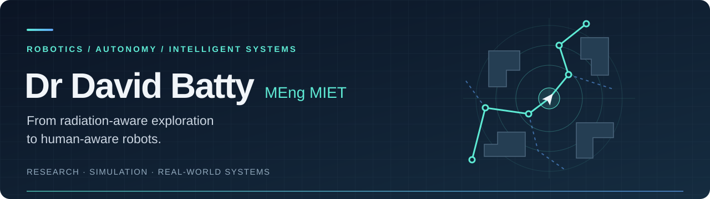
  
<strong>AI &amp; Cyberphysical Systems Engineer · Robotics Researcher · PhD, University of Liverpool</strong>

  
United Kingdom

  

    
    
    
    
    
  

  

    
    
    
    
    
    
  

I build research software connecting **human movement, robotic perception and physical action**. Select a project tile for its methods, demonstrations and validation results.

## Current Research

<a href="https://github.com/DavidBatty95/Skele-Tracker">
  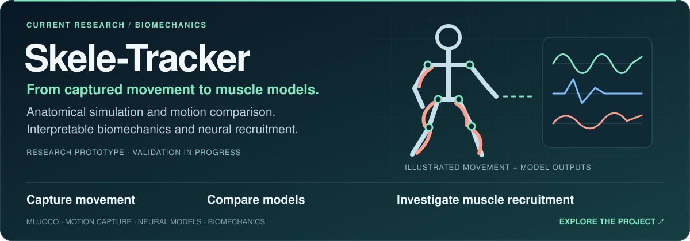
</a>

<a href="https://github.com/DavidBatty95/Dougie-Sim">
  
</a>

## Virtual Engineering Centre Projects

<a href="https://github.com/DavidBatty95/Geoff-Sim">
  
</a>

<a href="https://github.com/DavidBatty95/Geoff-Sim-VR">
  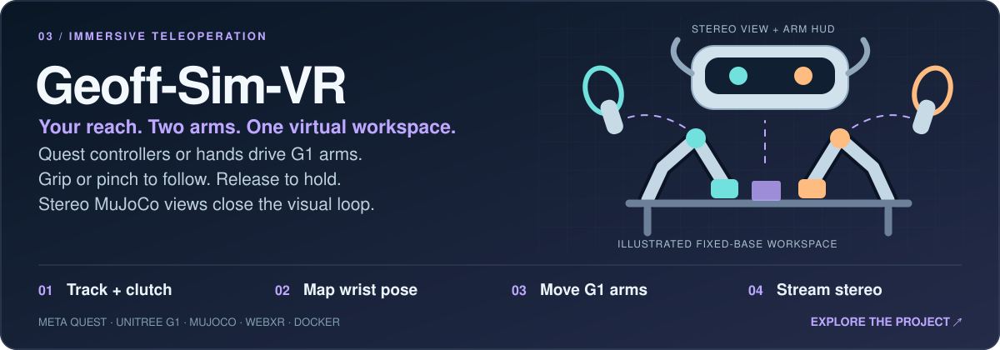
</a>

## PhD Research

[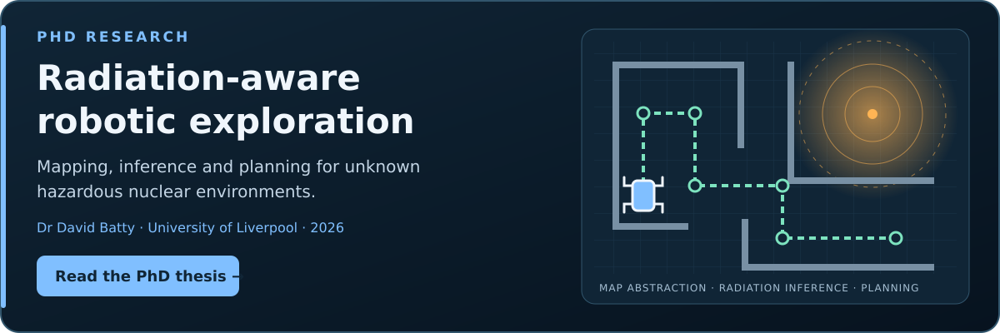](https://livrepository.liverpool.ac.uk/3199094/)

**Radiation Aware Navigation and Planning for Mobile Robot Exploration of Unknown Hazardous Nuclear Environments** — University of Liverpool, 2026. [Thesis and repository record](https://livrepository.liverpool.ac.uk/3199094/) · [DOI](https://doi.org/10.17638/03199094)

### Research Code

<table>
  <tr>
    <td width="33%"><a href="https://github.com/DavidBatty95/OccMapAbstraction-Python-Based">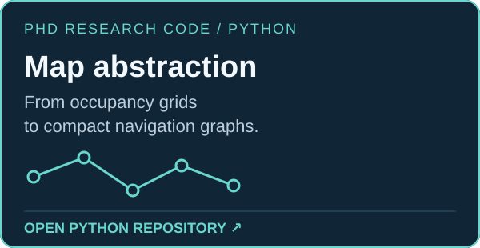</a></td>
    <td width="33%"><a href="https://github.com/DavidBatty95/OccMapAbstractionROS1Pkg">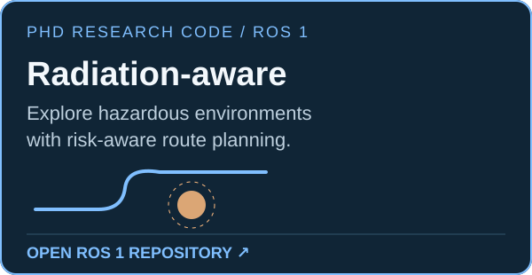</a></td>
    <td width="33%"><a href="https://github.com/DavidBatty95/Dougie-Sim">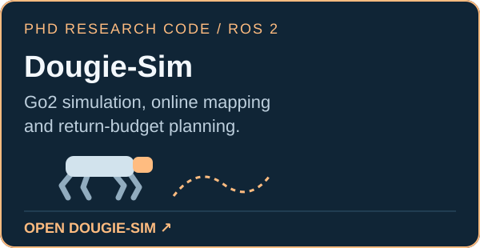</a></td>
  </tr>
</table>

### Selected publications

- **Real-World Testing of Ultrasonic Beacons for Mobile Robot Radiation Emulation** — Batty, West, Caliskanelli &amp; Paoletti. TAROS 2024. [Paper](https://doi.org/10.1007/978-3-031-72059-8_26)
- **Occupancy Map Abstraction for Higher Level Mission Planning of Autonomous Robotic Exploration in Hazardous Nuclear Environments** — Batty, Manes, West, Patel, Caliskanelli &amp; Paoletti. TAROS 2023. [Paper](https://doi.org/10.1007/978-3-031-43360-3_7)

## Web Development

### Aardvark Explorer Scout Unit

Freelance website development for a local Scout group in South Liverpool.

<table>
  <tr>
    <td width="76%"><a href="https://aardvarkesuwebsite.onrender.com/">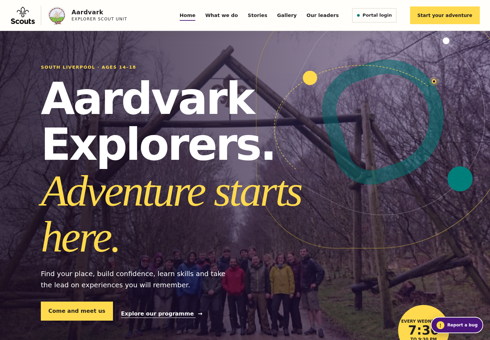</a></td>
    <td width="24%"><a href="https://aardvarkesuwebsite.onrender.com/">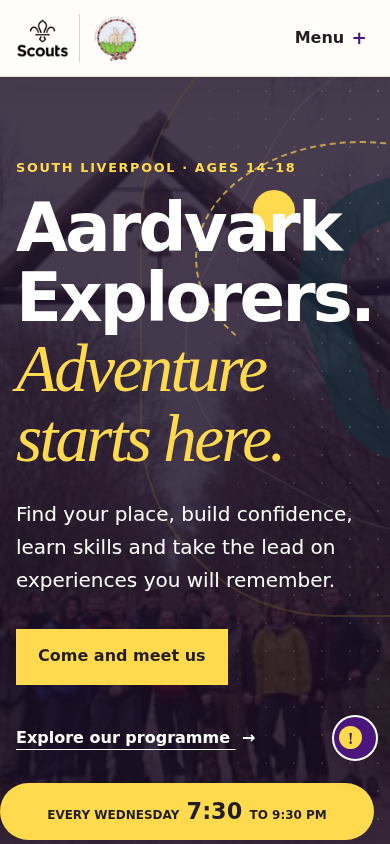</a></td>
  </tr>
</table>

Actual development-site screenshots, captured 7 October 2026.

## Other Projects

<a href="https://github.com/DavidBatty95/SonyEmotiBitAnalysis">
  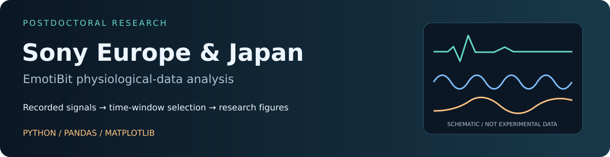
</a>

Project illustrations are schematics, not experimental evidence. Private repositories require access. [Asset provenance](assets/README.md).

---

  <strong>Research collaboration · Robotics · Freelance web development</strong> 
  <a href="mailto:dwbatty@liverpool.ac.uk">dwbatty@liverpool.ac.uk</a> ·
  <a href="https://uk.linkedin.com/in/david-batty">LinkedIn</a> ·
  <a href="https://orcid.org/0009-0003-5375-421X">ORCID</a> ·
  <a href="#top">Back to top ↑</a>

