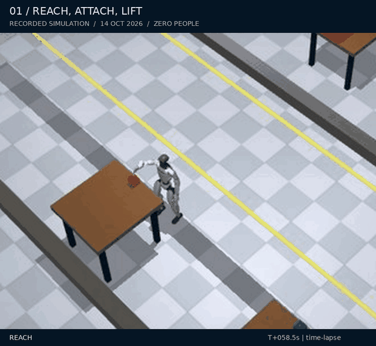
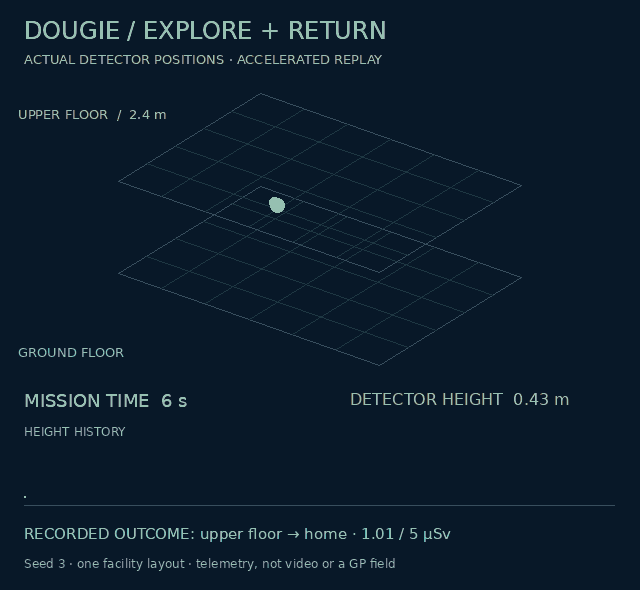

  

  
<strong>AI &amp; Cyberphysical Systems Engineer · Robotics Researcher · PhD, University of Liverpool</strong>

  
Virtual Engineering Centre · University of Liverpool · United Kingdom

  

    
    
    
    
  

  

    
    
    
    
    
    
  

## Building robots that understand their environment

I develop robotic systems that connect **perception, planning and physical action**. My work spans radiation-aware exploration in hazardous nuclear environments, humanoid simulation and human-aware navigation, and conversational robotics for public engagement.

My research brings together **compact map representations, probabilistic environmental modelling and risk-aware decision-making**, with a focus on turning algorithms into integrated, inspectable robotic systems.

Alongside robotics, I also do **freelance web development** for local groups and organisations.

---

## Current Research

Two complementary platforms for embodied autonomy: **handling objects in human
spaces** and **exploring hazardous environments with a return budget**.

### Robotics and autonomous systems

**From observing a scene to moving an object.** Geoff-Sim integrates RGB-D pickup,
measured arm execution, payload-aware locomotion, online mapping and human-aware
planning on the Unitree G1. Current research targets reliable task transitions,
low-latency control and repeatable delivery. Attachment is an experimental magnetic
fixture; reliable crowd delivery and contact-only grasping remain open.

**[Explore Geoff-Sim →](https://github.com/DavidBatty95/Geoff-Sim)** ·
[Recorded workflow](https://github.com/DavidBatty95/Geoff-Sim#recorded-demo-gallery) ·
[Engineering progress](https://github.com/DavidBatty95/Geoff-Sim/blob/main/docs/PROJECT_STATUS.md)

**Learn the environment while accounting for the journey home.** Dougie-Sim
connects physical Go2 locomotion, counting radiation measurements, online Gaussian
process inference and dose-aware planning. Recent development missions reached a
**2.4 m upper floor and returned home** within the declared exposure budget.
These are results on one simulated layout; full coverage and ordinary stairs
remain unqualified.

**[Explore Dougie-Sim →](https://github.com/DavidBatty95/Dougie-Sim)** ·
[Multi-level results](https://github.com/DavidBatty95/Dougie-Sim/blob/main/docs/DOUGIE_FULLHEIGHT_RESULTS.md) ·
[Mapping and planning](https://github.com/DavidBatty95/Dougie-Sim/blob/main/docs/DOUGIE_RADIATION.md)

#### From the actual experiments

| Geoff · pickup and loaded motion | Dougie · multi-level exploration and return |
| :---: | :---: |
|  |  |
| MuJoCo window recording, time-lapse. The source attempt later fell; this is not a complete-delivery clip. | Recorded XYZ detector trajectory, not video or a GP field. Seed 3 reached the upper level and returned; final exposure **1.01 / 5 µSv**. |

The project cards are original animated schematics. The previews below them
are separately labelled experimental evidence. <a href="assets/README.md#project-showcases">Media provenance and still images</a>.

[↑ Back to top](#top)

---

## PhD Research

> ### Radiation Aware Navigation and Planning for Mobile Robot Exploration of Unknown Hazardous Nuclear Environments
> **David Batty · PhD thesis · University of Liverpool · 2026**
>
> A unified framework for resource-constrained mobile robots to explore unknown nuclear environments while accounting for radiation exposure.
>
> **[Read the thesis at the University of Liverpool →](https://livrepository.liverpool.ac.uk/3199094/)** &nbsp; · &nbsp; [Permanent DOI](https://doi.org/10.17638/03199094)

The thesis connects four research contributions:

- **Occupancy-map abstraction** — transform dense occupancy grids into lightweight node–edge networks for higher-level planning.
- **Radiation-aware navigation** — incorporate hazard-weighted scoring and modified A* planning to balance exposure and travel distance.
- **Online environmental inference** — use Gaussian process regression to estimate radiation fields during exploration.
- **Physical validation** — combine ultrasonic radiation emulation with a ROS 2 implementation on the Unitree Go2 quadruped.

### Research code: from algorithms to hardware

| Repository | Research focus |
| :--- | :--- |
| [Occupancy-map abstraction · Python](https://github.com/DavidBatty95/OccMapAbstraction-Python-Based) | Benchmarking map abstraction for exploration of unknown environments |
| [Radiation-aware framework · ROS 1](https://github.com/DavidBatty95/OccMapAbstractionROS1Pkg) | Simulation testing of the radiation-aware abstraction framework |
| [Go2 experimental workspace · ROS 2](https://github.com/DavidBatty95/Go2OccMapAbstractionROS2ws) | Real-world testing of radiation-aware exploration on the Unitree Go2 |

### Selected publications

**Real-World Testing of Ultrasonic Beacons for Mobile Robot Radiation Emulation** 
David Batty, Andrew West, Ipek Caliskanelli and Paolo Paoletti. 
*Towards Autonomous Robotic Systems — TAROS 2024*, pp. 302–312. Springer; published online December 2024, volume year 2025. 
[Read publication →](https://doi.org/10.1007/978-3-031-72059-8_26)

**Occupancy Map Abstraction for Higher Level Mission Planning of Autonomous Robotic Exploration in Hazardous Nuclear Environments** 
David Batty, Lupo Manes, Andrew West, Maulik Patel, Ipek Caliskanelli and Paolo Paoletti. 
*Towards Autonomous Robotic Systems — TAROS 2023*, pp. 77–88. Springer, 2023. 
[Read publication →](https://doi.org/10.1007/978-3-031-43360-3_7)

[↑ Back to top](#top)

---

## Web Development

I also build **responsive websites for local groups and organisations**, bringing
the same attention to clear interfaces and practical delivery to my freelance
web-development work.

### Aardvark Explorer Scout Unit

A website I am developing for a **local Scout group in South Liverpool**,
bringing its programme, stories, gallery, leader information and joining routes
together in a clear desktop and mobile experience.

<table>
  <tr>
    <td width="76%" valign="top">
      
    </td>
    <td width="24%" valign="top">
      
    </td>
  </tr>
</table>

Actual screenshots of the public development site, captured 7 October 2026. Desktop and mobile browser views; the website continues to evolve.

`Freelance web development` · `Responsive design` · `Community websites` · `Render deployment`

**[Visit the live website →](https://aardvarkesuwebsite.onrender.com/)** &nbsp; · &nbsp;
**[Discuss a website project →](mailto:dwbatty@liverpool.ac.uk)**

[↑ Back to top](#top)

---

## Other Projects

Applied robotics for public engagement and previous research projects.

### [Pepper-Assistant](https://github.com/DavidBatty95/pepper_assistant)

**Conversational robotics for the Virtual Engineering Centre.** A voice-driven assistant for SoftBank Pepper, designed for demonstrations, tours and visitor Q&A. The system connects wake-word activation, voice activity detection, Vosk speech recognition, GPT-powered dialogue and a Pepper-side speech bridge, with a live terminal dashboard.

`Human–robot interaction` · `Python` · `Speech recognition` · `Conversational AI`

**[Explore Pepper-Assistant →](https://github.com/DavidBatty95/pepper_assistant)**

### EmotiBit Immersion Measurement — previous postdoctoral work

I developed this work during my **PostDoc for Sony Europe and Japan**. This is
previous research, rather than an ongoing project of mine. The Python workflow
supports inspection of EmotiBit physiological recordings through CSV loading,
time-window selection and sensor plotting.

The work continues to be used by Tom Gallagher in Professor Alan Marshall's
research group.

`Previous postdoctoral research` · `Physiological data` · `Python` · `pandas` · `Matplotlib`

**[Explore SonyEmotiBitAnalysis →](https://github.com/DavidBatty95/SonyEmotiBitAnalysis)**

The source repository is private and requires access. The illustration above is a schematic, not participant data. <a href="mailto:dwbatty@liverpool.ac.uk">Contact me about the research.</a>

[↑ Back to top](#top)

---

## Technical focus

| Robotics & autonomy | Modelling & intelligence | Engineering |
| :--- | :--- | :--- |
| ROS / ROS 2 · SLAM · navigation | Gaussian processes · radiation mapping | Python · Linux · Docker |
| Humanoids · quadrupeds · social robots | Map abstraction · risk-aware planning | Simulation · benchmarking · reproducible experiments |
| Unitree G1 · Unitree Go2 · Pepper | Speech recognition · conversational AI | MuJoCo · RViz · system integration |
| Experimental sensing · wearable data | Physiological time series · pandas · Matplotlib | Responsive websites · freelance web development |

---

  <strong>Let's connect on robotics, research collaboration and freelance web development.</strong> 
  <a href="mailto:dwbatty@liverpool.ac.uk">dwbatty@liverpool.ac.uk</a> &nbsp; · &nbsp;
  <a href="https://uk.linkedin.com/in/david-batty">LinkedIn</a> &nbsp; · &nbsp;
  <a href="https://orcid.org/0009-0003-5375-421X">ORCID</a>

