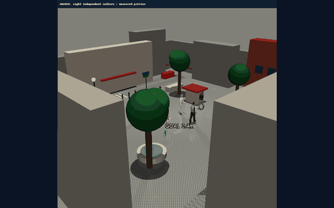
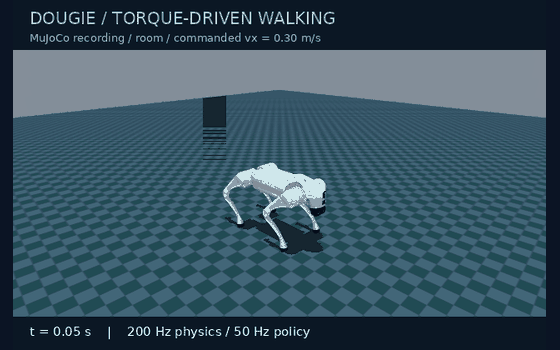

  

  
<strong>AI &amp; Cyberphysical Systems Engineer · Robotics Researcher · PhD, University of Liverpool</strong>

  
Virtual Engineering Centre · University of Liverpool · United Kingdom

  

    <a href="https://livrepository.liverpool.ac.uk/3199094/">PhD thesis</a> &nbsp; / &nbsp;
    <a href="#selected-publications">Publications</a> &nbsp; / &nbsp;
    <a href="https://orcid.org/0009-0003-5375-421X">ORCID</a> &nbsp; / &nbsp;
    <a href="https://uk.linkedin.com/in/david-batty">LinkedIn</a> &nbsp; / &nbsp;
    <a href="mailto:dwbatty@liverpool.ac.uk">Contact</a>
  

## Building robots that understand their environment

I develop robotic systems that connect **perception, planning and physical action**. My work spans radiation-aware exploration in hazardous nuclear environments, humanoid simulation and human-aware navigation, and conversational robotics for public engagement.

My research brings together **compact map representations, probabilistic environmental modelling and risk-aware decision-making**, with a focus on turning algorithms into integrated, inspectable robotic systems.

## Featured robotics projects

<table>
  <tr>
    <td width="50%" valign="top">
      <h3><a href="https://github.com/DavidBatty95/Geoff-Sim">Geoff-Sim</a></h3>
      
<strong>Humanoid autonomy around people</strong>

      
      
Unitree G1 research platform combining locomotion, simulated onboard sensing, online mapping and human-aware navigation in reproducible environments.

      
<code>Unitree G1</code> <code>ROS 2</code> <code>MuJoCo</code>

      
<a href="https://github.com/DavidBatty95/Geoff-Sim">Explore Geoff-Sim →</a>

    </td>
    <td width="50%" valign="top">
      <h3><a href="https://github.com/DavidBatty95/Dougie-Sim">Dougie-Sim</a></h3>
      
<strong>Quadruped exploration under radiation constraints</strong>

      
      
Unitree Go2 simulation connecting physical locomotion, radiation sensing, online Gaussian process mapping and dose-aware exploration with return-budget reasoning.

      
<code>Unitree Go2</code> <code>Gaussian processes</code> <code>MuJoCo</code>

      
<a href="https://github.com/DavidBatty95/Dougie-Sim">Explore Dougie-Sim →</a>

    </td>
  </tr>
</table>

Recorded simulation previews from separate runs; project documentation contains the evaluation results. Geoff-Sim and Dougie-Sim are currently private repositories: source links require access. <a href="mailto:dwbatty@liverpool.ac.uk">Contact me about the projects.</a>

### [Pepper-Assistant](https://github.com/DavidBatty95/pepper_assistant)

**Conversational robotics for the Virtual Engineering Centre.** A voice-driven assistant for SoftBank Pepper, designed for demonstrations, tours and visitor Q&A. The system connects wake-word activation, voice activity detection, Vosk speech recognition, GPT-powered dialogue and a Pepper-side speech bridge, with a live terminal dashboard.

`Human–robot interaction` · `Python` · `Speech recognition` · `Conversational AI`

**[Explore Pepper-Assistant →](https://github.com/DavidBatty95/pepper_assistant)**

## PhD research

> ### Radiation Aware Navigation and Planning for Mobile Robot Exploration of Unknown Hazardous Nuclear Environments
> **David Batty · PhD thesis · University of Liverpool · 2026**
>
> A unified framework for resource-constrained mobile robots to explore unknown nuclear environments while accounting for radiation exposure.
>
> **[Read the thesis at the University of Liverpool →](https://livrepository.liverpool.ac.uk/3199094/)** &nbsp; · &nbsp; [Permanent DOI](https://doi.org/10.17638/03199094)

The thesis connects four research contributions:

- **Occupancy-map abstraction** — transform dense occupancy grids into lightweight node–edge networks for higher-level planning.
- **Radiation-aware navigation** — incorporate hazard-weighted scoring and modified A* planning to balance exposure and travel distance.
- **Online environmental inference** — use Gaussian process regression to estimate radiation fields during exploration.
- **Physical validation** — combine ultrasonic radiation emulation with a ROS 2 implementation on the Unitree Go2 quadruped.

### Research code: from algorithms to hardware

| Repository | Research focus |
| :--- | :--- |
| [Occupancy-map abstraction · Python](https://github.com/DavidBatty95/OccMapAbstraction-Python-Based) | Benchmarking map abstraction for exploration of unknown environments |
| [Radiation-aware framework · ROS 1](https://github.com/DavidBatty95/OccMapAbstractionROS1Pkg) | Simulation testing of the radiation-aware abstraction framework |
| [Go2 experimental workspace · ROS 2](https://github.com/DavidBatty95/Go2OccMapAbstractionROS2ws) | Real-world testing of radiation-aware exploration on the Unitree Go2 |

## Selected publications

**Real-World Testing of Ultrasonic Beacons for Mobile Robot Radiation Emulation** 
David Batty, Andrew West, Ipek Caliskanelli and Paolo Paoletti. 
*Towards Autonomous Robotic Systems — TAROS 2024*, pp. 302–312. Springer; published online December 2024, volume year 2025. 
[Read publication →](https://doi.org/10.1007/978-3-031-72059-8_26)

**Occupancy Map Abstraction for Higher Level Mission Planning of Autonomous Robotic Exploration in Hazardous Nuclear Environments** 
David Batty, Lupo Manes, Andrew West, Maulik Patel, Ipek Caliskanelli and Paolo Paoletti. 
*Towards Autonomous Robotic Systems — TAROS 2023*, pp. 77–88. Springer, 2023. 
[Read publication →](https://doi.org/10.1007/978-3-031-43360-3_7)

## Technical focus

| Robotics & autonomy | Modelling & intelligence | Engineering |
| :--- | :--- | :--- |
| ROS / ROS 2 · SLAM · navigation | Gaussian processes · radiation mapping | Python · Linux · Docker |
| Humanoids · quadrupeds · social robots | Map abstraction · risk-aware planning | Simulation · benchmarking · reproducible experiments |
| Unitree G1 · Unitree Go2 · Pepper | Speech recognition · conversational AI | MuJoCo · RViz · system integration |

---

  <strong>Let's connect on robotics, autonomous systems and research collaboration.</strong> 
  <a href="mailto:dwbatty@liverpool.ac.uk">dwbatty@liverpool.ac.uk</a> &nbsp; · &nbsp;
  <a href="https://uk.linkedin.com/in/david-batty">LinkedIn</a> &nbsp; · &nbsp;
  <a href="https://orcid.org/0009-0003-5375-421X">ORCID</a>

